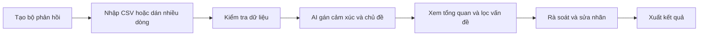
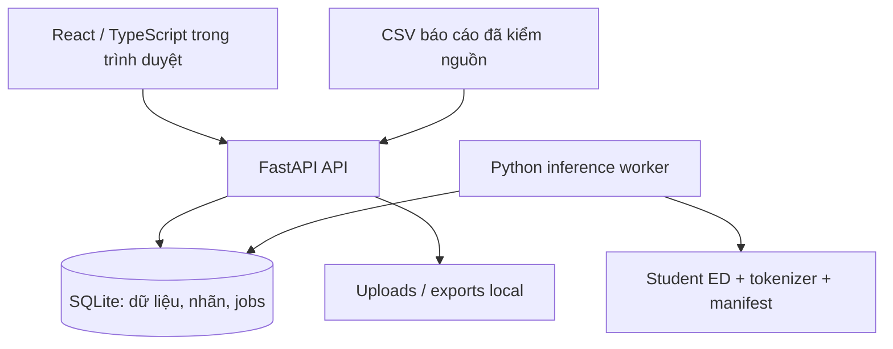

# Kế hoạch full web app demo: công cụ phân tích phản hồi sinh viên

Ngày cập nhật: 2026-11-06. Trạng thái: đề xuất triển khai, chưa viết app.

Đã xác nhận với người dùng: ưu tiên **công cụ sử dụng được**, báo cáo là tab phụ; **chạy local trước**, có thể đưa lên web sau. Người dùng giao quyền đề xuất giữa JavaScript và Python. Bản hiểu code/dữ liệu nằm ở `PROJECT_UNDERSTANDING.md`; ngữ cảnh sản phẩm ở `../PRODUCT.md`.

## 1. Đề xuất trong một phút

Tên làm việc: **NEU-ESC Feedback Workspace**. Có thể đổi tên sau; chưa có nhận diện thương hiệu được chốt.

Hãy hình dung một bảng làm việc: bạn đưa vào vài trăm phản hồi; công cụ đọc từng dòng, gắn cảm xúc và chủ đề; bạn thấy nhóm vấn đề nào xuất hiện nhiều, mở các câu cần kiểm tra, sửa khi AI đoán sai, rồi tải bảng kết quả về. Lần sau mở app, bộ phản hồi và phần đã duyệt vẫn còn.

Điểm khác biệt so với một ô nhập câu để demo AI là **vòng công việc hoàn chỉnh**:



Ví dụ minh họa do người viết kế hoạch tạo, **chưa phải kết quả model**: “Phòng học nóng, máy chiếu hay bị mờ.” Với chế độ đánh giá đào tạo, kết quả mong đợi về nghiệp vụ là “Tiêu cực / Cơ sở vật chất”. Khi triển khai phải chạy model thật để biết nó dự đoán gì; không hardcode nhãn mong đợi vào demo.

## 2. JavaScript hay Python?

**Chọn TypeScript cho web và giữ Python cho AI.** TypeScript thuộc hệ JavaScript, bổ sung kiểu dữ liệu để giảm lỗi ở bảng, API và các trạng thái xử lý.

| Phương án | Phù hợp ở đâu? | Đánh giá cho repo này |
|---|---|---|
| Python + Streamlit | Làm nhanh màn thử model và biểu đồ nội bộ | Hợp prototype kiểm model; ít thuận tiện hơn khi cần import nhiều bước, bảng chỉnh nhãn, job nền và điều hướng riêng |
| JavaScript/TypeScript toàn bộ | Web giàu tương tác, một hệ ngôn ngữ | Cần export/port model custom sang ONNX hoặc runtime JS, kiểm tokenizer/segmentation/parity; repo chưa có weights nên làm vậy thêm một tầng rủi ro |
| **React/TypeScript + Python API** | Giao diện công cụ tốt, giữ nguyên hệ ML | **Khuyến nghị**; không viết lại nghiên cứu bằng JS, vẫn dễ phát triển web |

Stack đề xuất:

- Frontend: React + TypeScript + Vite; React Router; TanStack Query và Table; Recharts cho biểu đồ vừa đủ; Radix/shadcn primitives cho điều khiển truy cập được, điều chỉnh bố cục theo công việc.
- Backend: FastAPI + Pydantic; SQLAlchemy + Alembic; Python/PyTorch/Transformers tương thích code hiện tại và được khóa version sau kiểm parity.
- Lưu dữ liệu: SQLite local, WAL, một worker xử lý inference; file upload/export và model ở thư mục runtime riêng được gitignore.
- Kiểm thử: pytest cho pipeline/API/job; Playwright cho một số luồng E2E quan trọng.
- Packaging: khóa dependency frontend/Python; script PowerShell chạy local. Docker là phương án đóng gói thêm, không là điều kiện để dùng bản Windows đầu tiên.

Không cần Next.js/SSR vì đây là công cụ nội bộ không có nhu cầu SEO; chưa cần Redis, Celery, PostgreSQL hay Kubernetes cho một người dùng local.

## 3. Phạm vi “full demo”

Full demo là hoàn thành vòng công việc trên với model thật và dữ liệu lưu bền, không có nút giả. Nó không có nghĩa đưa mọi thí nghiệm training lên UI.

### Hai loại nội dung, dùng hai model riêng

| Lựa chọn người dùng thấy | Dùng khi nào? | Model/schema |
|---|---|---|
| **Thảo luận sinh viên** | Bài đăng, chia sẻ, học tập, dịch vụ, việc làm, câu lạc bộ… | NEU: 4 cảm xúc + 10 chủ đề |
| **Đánh giá đào tạo** | Nhận xét về giảng viên, chương trình, phòng học… | UIT: 3 cảm xúc + 4 chủ đề |

Người dùng chọn loại nội dung lúc tạo bộ phản hồi, không phải chọn tên backbone. App giải thích bằng ví dụ ngắn và cho xem danh sách nhãn. Model/version nằm trong phần chi tiết kỹ thuật. Profile/schema của một bộ phản hồi là bất biến. Muốn đổi loại nội dung, tạo bản sao bộ phản hồi với schema mới, chỉ mang theo văn bản và metadata; không mang theo nhãn AI, nhãn tham chiếu hoặc nhãn đã duyệt của schema cũ. Bộ cũ và lịch sử vẫn giữ nguyên.

Triển khai một lát cắt hoàn chỉnh với NEU trước, sau đó bật UIT bằng artifact riêng. Phạm vi full được đề xuất gồm cả hai; nếu một artifact chưa có thì chế độ đó ghi rõ chưa sẵn sàng, không coi toàn bộ phạm vi đã hoàn thành.

### Có trong bản full

1. Tạo/mở/xóa bộ phản hồi, lưu lịch sử local.
2. Nhập CSV, dán nhiều dòng và thử một câu nhanh.
3. Preview, chọn cột văn bản, kiểm lỗi và xác nhận dữ liệu trước chạy.
4. Phân loại thật, job nền có tiến độ, hủy và chạy lại phần lỗi.
5. Tổng quan theo chủ đề/cảm xúc, lọc và tìm văn bản gốc.
6. Hàng chờ rà soát; xác nhận/sửa nhãn, ghi chú, hoàn tác lần sửa bằng revision mới.
7. Xuất CSV toàn bộ hoặc phần đã lọc, kèm nguồn nhãn và model version.
8. Tab báo cáo ngắn, hướng dẫn dùng và trạng thái model.

### Để sau

- Đăng nhập nhiều vai trò, phân quyền tổ chức, quản lý nhiều người dùng.
- Thu thập bài từ mạng xã hội, kết nối hệ thống nhà trường, đồng bộ Google Sheets.
- Chatbot, tóm tắt sinh bằng LLM, tự soạn câu trả lời sinh viên.
- Huấn luyện trong app, tự học lại từ sửa nhãn, slider gamma ED/SMART.
- Highlight từ như thể là giải thích nhân quả của model.
- So sánh nhiều model live, ONNX/quantization hoặc GPU tối ưu trước khi có benchmark CPU.
- Bảng theo môn/khoa/thời gian khi dữ liệu chưa cung cấp các trường thật đó.

## 4. Các màn hình và hành vi cụ thể

### 4.1. Trang vào: Bộ phản hồi

Mục đích là chọn công việc đang làm. Hiện danh sách bộ dữ liệu với tên, loại nội dung, số dòng, trạng thái phân tích và số dòng đã rà soát. Ngày trên danh sách là ngày nhập vào app, không giả là ngày viết phản hồi.

Hành động chính: **Tạo bộ phản hồi**. Hành động phụ: **Thử một câu**. Lần đầu chưa có dữ liệu, hướng dẫn ba bước ngắn và cho nhập bộ ví dụ tự viết có nhãn “Dữ liệu minh họa”; nếu chạy AI trên ví dụ, output vẫn phải do model thật tạo.

### 4.2. Nhập dữ liệu

Luồng: chọn loại nội dung → đặt tên → CSV hoặc dán văn bản → chọn cột → preview → nhập và phân tích.

- CSV: nhận UTF-8 có/không BOM; nhận diện dấu phân cách thông dụng và cho người dùng xác nhận qua preview. Không đoán encoding khác rồi tạo chữ lỗi im lặng.
- Có cột `text` thì gợi ý sẵn; tên khác cho chọn trong dropdown. Metadata bổ sung được giữ nguyên như dữ liệu do người dùng cung cấp.
- Cột `sentiment`/`classification` có trong file benchmark chỉ trở thành nhãn tham chiếu sau khi người dùng xác nhận nguồn và map/validate cả giá trị nhãn theo schema. Cùng số ID ở NEU và UIT có nghĩa khác nhau; cột không map được được giữ như metadata kèm cảnh báo, không tự coi là gold. Nhãn tham chiếu không vào input model và không trộn với nhãn người dùng sửa.
- Báo số dòng trống/quá dài/trùng. Không tự xóa các phản hồi trùng: nhiều người có thể gửi cùng nội dung. Cho bỏ dòng lỗi bằng thao tác rõ ràng.
- Dán nhiều dòng: mỗi dòng không trống là một phản hồi; muốn nội dung nhiều dòng trong một ô thì dùng CSV đã quote hoặc chỉnh riêng dòng đó.
- Giới hạn tạm thời cho demo CPU: 500 dòng/bộ, file 5 MB, 5.000 ký tự/dòng. Đây là giới hạn sản phẩm dự kiến, phải điều chỉnh sau benchmark; model vẫn chỉ đọc tối đa 128 token theo pipeline gốc.
- Dòng bị truncation được đánh dấu và giải thích; không âm thầm biến bài dài thành kết luận cho toàn bài. Chia đoạn và tổng hợp nhiều đoạn là tính năng khác, chưa thuộc v1.

### 4.3. Không gian một bộ phản hồi

Sau khi nhập, mở một trang công việc với ba khu vực: Tổng quan, Tất cả phản hồi, Cần rà soát. Không bắt người dùng quay ra danh sách để xem từng câu.

Sơ đồ bố cục chức năng, chưa phải mockup chốt màu/font:

```text
Bộ phản hồi / Góp ý sinh viên             [Phân tích] [Xuất CSV]
Đánh giá đào tạo · Model sẵn sàng · Đã xử lý 120/120

Tổng quan          Tất cả phản hồi          Cần rà soát
----------------------------------------------------------------
Lọc: [Chủ đề] [Cảm xúc] [Trạng thái duyệt] [Tìm nội dung...]

Phân bố theo chủ đề          Cảm xúc trong từng chủ đề
(bấm một nhóm để lọc)        (có số lượng và tỷ lệ cùng mẫu số)
----------------------------------------------------------------
Nội dung                     Cảm xúc   Chủ đề       Duyệt
...                          ...      ...          Chưa duyệt
...                          ...      ...          Đã sửa

Chọn dòng → xem nguyên văn, điểm model, nhãn người duyệt, ghi chú
```

**Tổng quan**:

- Tổng số dòng, số đã xử lý, số cần rà soát và tiến độ duyệt.
- Biểu đồ thanh cảm xúc; thanh ngang chủ đề; bảng giao cảm xúc × chủ đề.
- Bấm vào một thanh/ô để mở danh sách phản hồi tương ứng, luôn có đường trở lại tổng quan và bỏ filter.
- Thống kê vận hành mặc định dùng “nhãn đã duyệt nếu có, còn lại nhãn AI” theo từng task; có nhãn rõ về quy tắc này. Hiện số dòng đã duyệt đủ hai task và số đang duyệt một phần. Có thể chuyển sang “chỉ dự đoán gốc” để đối chiếu.
- Chỉ tính tỷ lệ trên những dòng đã có kết quả; ghi mẫu số. Khi job chưa xong, ghi “kết quả tạm thời”. Toxic NEU là lớp riêng, không tự cộng vào Negative mà không ghi rõ.
- Các câu nhận xét tổng hợp là template theo số liệu, ví dụ “Chủ đề X có N phản hồi tiêu cực trong M phản hồi thuộc chủ đề”; không tự suy ra nguyên nhân hoặc sự kiện ngoài văn bản.

**Tất cả phản hồi**:

- Tìm kiếm, filter, sort, phân trang server, chọn nhiều dòng để xuất/đánh dấu đã rà soát nếu phù hợp.
- Bảng ưu tiên nguyên văn, cảm xúc, chủ đề, trạng thái duyệt. Các điểm số và version mở trong panel chi tiết để bảng không quá tải.
- Click một dòng mở panel bên cạnh trên desktop; trên mobile mở trang chi tiết. Đóng panel giữ vị trí, filter và trang bảng.

**Cần rà soát**:

- Bao gồm dòng truncation, dòng lỗi và dòng điểm top-1 thấp theo rule cấu hình; Toxic NEU có thể được ưu tiên rà soát thủ công.
- Điểm thấp là tín hiệu vận hành, không bảo đảm phát hiện mọi lỗi. Nếu dùng ngưỡng mặc định, ghi đây là heuristic chưa hiệu chuẩn, lưu rule version; hiệu chỉnh bằng validation, không tune theo test.
- Không tự biến dự đoán dưới ngưỡng thành một lớp sentiment mới; model vẫn trả argmax, cờ rà soát lưu riêng.
- Người dùng chọn nhãn đúng, thêm ghi chú, **Lưu và câu tiếp theo**. Trạng thái của từng task là `unreviewed`, `confirmed` hoặc `corrected`; xác nhận nhãn AI đúng vẫn lưu nhãn đã xác nhận và prediction nguồn. Sửa sentiment không tự xác nhận topic. Luôn còn thấy dự đoán gốc; undo tạo revision để audit được.
- Một lần chạy model mới không xóa nhãn đã duyệt; bản duyệt gắn với input revision và schema, cảnh báo nếu nội dung/schema thay đổi.

### 4.4. Thử một câu

Mở nhanh từ sidebar/header. Chọn loại nội dung, nhập văn bản, chạy. Hiện hai nhãn, phân phối điểm cho từng nhãn trong mục mở rộng, dấu truncation nếu có, và thông tin model ở cuối.

Từ ngữ UI: **“Điểm mô hình”**, không “độ chính xác của câu”. Không lấy accuracy trong báo cáo đặt vào câu mới. Có nút thêm câu vào một bộ phản hồi cùng schema nếu muốn lưu. Văn bản thử nhanh được lưu tạm để worker xử lý, không thành lịch sử lâu dài mặc định; TTL dự kiến 15 phút sau khi kết thúc, cleanup cả khi lỗi/hủy và khi startup. Backup loại nội dung quick-job khỏi bản sao; API/log không giữ bản sao text ngoài nơi lưu tạm được quản lý. UI nói rõ chính sách lưu tạm này.

### 4.5. Báo cáo mô hình

Một tab nhỏ, không nằm trên đường công việc bắt buộc. Mặc định một bảng baseline MTL vs ED theo dataset/backbone và hai metric Accuracy, Macro-F1, có mean/std/số seed và giải thích ngắn.

Chỉ dùng reports thật; phân biệt model đang cài trên máy với cohort lịch sử. Không dựng confusion matrix riêng từ summary vì chưa có predictions/logits cấp câu. Không dùng Figure 3 paper như kết quả nhóm. Không cần toàn bộ oracle, bias và kiểm định thống kê ở màn mặc định.

### 4.6. Trạng thái và trợ giúp

Hiện model/profile nào đã cài, phiên bản, CPU, tình trạng load/warmup và job. Hướng dẫn chuẩn bị CSV, giải thích nhãn và chỗ lưu dữ liệu local. Cho xóa bộ phản hồi sau xác nhận; không xóa weights dùng chung khi xóa dữ liệu.

## 5. Nguyên tắc giao diện

Đây là app thao tác thường xuyên trên laptop trong môi trường làm việc có ánh sáng. Đề xuất giao diện sáng, bảng rõ, vùng nội dung rộng; palette/font cuối cùng chưa chốt. Ưu tiên font sans hỗ trợ đầy đủ dấu tiếng Việt, kích thước chữ bảng đủ đọc, màu nhãn đi cùng chữ/icon.

- Trên desktop: sidebar gọn và một vùng làm việc; không landing page hay hero giới thiệu chiếm diện tích.
- Tiết lộ dần: người dùng chọn loại nội dung; architecture, seed, hash nằm trong thông tin mở rộng.
- Bảng và chart chung bộ filter; tên bộ dữ liệu và hành động đang làm luôn nhìn thấy.
- Trên điện thoại: điều hướng thu gọn, hàng bảng đổi thành danh sách tóm tắt; chi tiết và sửa nhãn dùng được, không bắt xem desktop thu nhỏ.
- Keyboard focus, nhãn form, contrast, thông báo lỗi gắn đúng ô; trạng thái không phụ thuộc chỉ màu.
- Motion chỉ để báo đổi trạng thái hoặc mở panel; không dùng hiệu ứng load trang gây chờ.

Đây là đề xuất cấu trúc để hình dung sản phẩm, không phải visual identity đã được người dùng phê duyệt. Sau khi chốt chức năng mới làm wireframe/mockup chi tiết và hệ thống thiết kế.

## 6. Kiến trúc local và đường lên web



Local production: build frontend thành static assets, FastAPI phục vụ cùng origin trên `127.0.0.1`; script PowerShell khởi động API và một worker nền. Development: Vite proxy `/api` tới FastAPI, không mở CORS rộng.

Worker riêng giữ model trong RAM, chạy `eval()` và `inference_mode()`. Không gọi training hoặc tải lại model trong mỗi request. Giai đoạn đầu chỉ giữ một model đang dùng để giới hạn RAM; khi đổi profile có trạng thái nạp rõ ràng. Không hứa đổi model tức thời.

Jobs lưu trong SQLite, không chỉ trong biến RAM/`BackgroundTasks`. Worker claim atomic bằng transaction ngắn, cấp `lease_owner`, `lease_expires_at`, `attempt_id`, rồi nhả transaction trước inference. Mỗi microbatch commit kiểm attempt/lease còn hợp lệ, ghi predictions và progress trong cùng transaction. Worker cũ tỉnh lại sau khi lease hết không được ghi tiếp. Script local chặn khởi động trùng worker. UI poll tiến độ khoảng 1–2 giây khi đang chạy, dừng poll khi terminal. Không cần WebSocket cho v1.

Job một câu cũng dùng worker, ưu tiên giữa các microbatch của job lớn; API có thể trả kết quả sẵn nếu hoàn tất nhanh hoặc trả `202` cùng job ID để UI theo dõi. Không chạy hai model đồng thời để lấy cảm giác nhanh mà gây hết RAM.

Khi lên web: giữ React/API contract; chuyển database sang PostgreSQL, lưu file/object ngoài container, đưa model vào worker hosting riêng, thêm đăng nhập/session isolation/quota/TLS và queue nhiều worker nếu thực sự cần. Không deploy PyTorch CPU nhiều trăm MB vào function serverless rồi mặc định coi cold start đã giải quyết.

## 7. Model phục vụ ứng dụng: bước bắt buộc

### 7.1. Lựa chọn ban đầu

Ưu tiên **ViSoBERT MTL-ED** riêng cho NEU và UIT vì đường raw text đã có trong training, giảm bất định tách từ khi nhập tự do. Đây là lựa chọn triển khai thực dụng, không tuyên bố ViSoBERT nhanh hơn hoặc chính xác hơn PhoBERT.

PhoBERT ED có sentiment/macro-F1 tốt hơn ở các bảng chính; thêm sau khi pipeline tách từ cho từng dataset được pin và kiểm thử. UIT có thể dùng underthesea theo README; NEU cần xử lý sự khác biệt với preprocessing tác giả và đánh giá riêng.

Seed triển khai cố định trước khi xem test, ví dụ 42. Nếu chọn giữa các checkpoint, chỉ dùng tiêu chí validation đã khai báo và lưu lý do. Không lấy seed có test cao nhất.

### 7.2. Nhánh artifact

1. Kiểm kê artifact ở nơi nhóm lưu: có weights fine-tune, tokenizer, manifest, OOF teacher probabilities và raw run outputs không?
2. Nếu có weights: kiểm đúng architecture, tensor keys, schema, input pipeline và provenance; không coi file tên “best” là đủ.
3. Nếu không có weights nhưng có OOF: kiểm hash/order/coverage/dataset, thêm export ngay trong runner rồi train lại student ED. Sau `load_state_dict(best_state)` và trước khi process thoát, hook ghi đầy đủ encoder + hai heads, tokenizer/config và manifest vào staging bundle. Reload/parity thành công mới đổi tên thành artifact hoàn chỉnh. Script export độc lập không thể khôi phục weights đã mất từ một run lịch sử; không export ngẫu nhiên heads pretrained hay optimizer/teacher ensemble thay student.
4. Nếu thiếu cả OOF: dựng lại teacher OOF và student. Báo cáo NEU ước lượng teacher khoảng 16 GPU-hours; đó là thời gian lịch sử trên môi trường thí nghiệm, không cam kết thời gian máy này. Ưu tiên GPU Kaggle/host riêng, không lên kế hoạch train full trên laptop CPU.
5. Trong lúc chờ weights có thể làm import/table/review bằng fixture gắn nhãn development. Bản nghiệm thu phải chạy model thật; UI thiếu weights trả trạng thái chưa sẵn sàng.

Không cần chạy lại toàn bộ 15/10 seed để làm app. Chỉ cần artifact hợp lệ cho những model định triển khai; báo cáo lịch sử vẫn dùng bảng aggregate riêng.

### 7.3. Artifact bundle

Mỗi model có weights, tokenizer/config và `manifest.json` gồm:

- model ID/version, dataset/profile, architecture/backbone/revision;
- label ID/order/tên, max length, normalization/segmentation version;
- seed, validation selection criterion, best epoch, validation score;
- source commit/runner SHA, hash weights, hash dữ liệu/OOF dùng train;
- library versions, dtype, ngày export; bias config nếu thật sự có dùng.

Inference adapter tách khỏi CLI training. Có thể tái dùng factory kiến trúc ban đầu nhưng tránh kéo module train/network fetch vào startup API. Nếu tách factory chung, phải giữ regression parity trước/sau; không sửa công thức train như một side effect làm web.

### 7.4. Các điều kiện để bật nút Phân tích

- Export→reload cho cùng batch giữ logits trong tolerance đã đo và nhãn đúng; kiểm cả hai heads, batch size khác nhau và thứ tự dòng.
- Schema đúng: NEU 4/10, UIT 3/4; tokenizer/preprocess khớp manifest.
- Backend trả score hữu hạn và tổng softmax mỗi head gần 1; đây chỉ là kiểm số học, không chứng minh calibration.
- Test raw tiếng Việt, dấu câu, emoji, teencode, câu ngắn/dài và empty input.
- Đo cold load, warm single inference, batch 10/100/500, peak RAM trên máy local. Chốt batch size/thread count/giới hạn theo phép đo; chưa đặt SLA giả.
- Khi model thiếu/hỏng, `/models` báo không sẵn sàng, job từ chối có thông báo; không tự tải model khác hoặc sinh kết quả mẫu.

## 8. Dữ liệu ứng dụng và tính nhất quán

| Bảng/thực thể | Các trường chính | Quy tắc |
|---|---|---|
| `datasets` | id, name, profile, created_at, source_file, import_status | Tên “bộ phản hồi” trên UI; timestamp chỉ là thời gian trong app |
| `feedback_items` | id, dataset_id, source_row, current_revision_id | Định danh ổn định và thứ tự; không tự gộp duplicate |
| `item_revisions` | id, item_id, revision, text, text_hash, metadata_json, created_at | Nội dung bất biến từng revision; đủ tái tạo lịch sử sau sửa text |
| `reference_labels` | item_revision_id, schema_id, task, label_id, source, mapping_version | Nhãn tham chiếu đã map/validate, tách hoàn toàn khỏi predictions và reviews |
| `models` | model_id, manifest, artifact_hash, availability | Model registry và schema cố định |
| `analysis_runs` / `run_items` | run_id, dataset_id, schema_id, model_id/version, item_revision_id, state, totals | Mỗi lần chạy giữ tập item revision bất biến, không chỉ số revision của nội dung đang bị ghi đè |
| `predictions` | run_id, item_id, input_revision, logits/scores, label IDs, warnings, duration | Unique theo run/item/revision; giữ kết quả model bất biến |
| `reviews` | item_revision_id, schema_id, task, status, label_id, source_prediction_id, note, review_revision, reviewed_at | Review theo từng task; xác nhận không đổi nhãn vẫn có record; optimistic concurrency |
| `jobs` | id, run_id, status, progress, heartbeat, lease_owner, lease_expires_at, attempt_id, cancel_requested, error_code | Recovery có fencing, worker cũ không ghi đè attempt mới |
| `exports` | id, dataset/run, selected item revision IDs, filters, label_source, review revision IDs, created_at, path | Materialize snapshot dòng xuất và nhãn tham chiếu/duyệt để tái tạo đúng sau các lần sửa tiếp |

Với bản local một người không cần hồ sơ tổ chức, billing hoặc RBAC. Vẫn có migration database từ đầu để sau này lên PostgreSQL không phải viết lại mọi logic.

Vòng đời job: `queued → loading_model → running → completed/completed_with_errors`; nhánh `cancelled/failed/interrupted`. Lưu từng batch; worker chết thì job hết lease chuyển interrupted, tiếp tục chỉ các dòng chưa thành công khi chạy lại đúng model/input revision. Cancel được kiểm giữa batch và giữ kết quả đã hoàn thành. Retry chỉ tạo attempt mới sau khi attempt trước đã kết thúc hoặc hết lease; unique constraint và fencing ngăn duplicate/stale writes.

Khi sửa văn bản, tạo item revision mới và đánh dấu kết quả cũ stale ở view hiện tại; nội dung cũ vẫn tồn tại để mở lịch sử. Nhãn tham chiếu và nhãn đã duyệt không tự chuyển sang văn bản mới. Mọi chart/export truy vấn cùng một `analysis_run_id` và cùng quy tắc nguồn nhãn để không trộn các phiên bản. Dashboard của run mặc định dùng review mới nhất còn khớp revision/schema, có nhãn “bản duyệt hiện tại”; khi chọn xem dự đoán gốc thì chỉ dùng predictions bất biến. Export khóa review revision tại lúc tạo, không thay đổi theo review về sau. Nhãn tham chiếu không là fallback cho nhãn vận hành và không dùng tính accuracy nếu người dùng chưa xác nhận nguồn phù hợp.

## 9. API đề xuất

Tất cả dưới `/api/v1`, body có schema rõ ràng và lỗi có `code`, thông báo dễ hiểu, trường/dòng liên quan. OpenAPI là nguồn sinh TypeScript types; không chép hai bộ label map bằng tay.

| Endpoint | Chức năng |
|---|---|
| `GET /health`, `GET /models` | Trạng thái API/worker/model và schema nhãn |
| `POST /imports/preview` | Kiểm file, delimiter/encoding/cột, trả mẫu và lỗi; chưa chạy AI |
| `POST /datasets` | Commit import đã xác nhận hoặc nhập text; trả dataset ID |
| `GET /datasets`, `GET /datasets/{id}` | Danh sách và thông tin bộ phản hồi |
| `POST /datasets/{id}/copy` | Sao chép văn bản/metadata sang bộ mới, chọn profile; không mang nhãn sang schema khác |
| `DELETE /datasets/{id}` | Xóa dữ liệu thuộc bộ đó; xử lý job đang chạy trước |
| `POST /analysis-runs` | Tạo job cho dataset/profile; chặn model/schema không khớp |
| `GET /datasets/{id}/analysis-runs`, `GET /analysis-runs/{id}` | Liệt kê/mở snapshot run và lịch sử |
| `POST /quick-analysis` | Một câu dùng cùng inference worker, trả result hoặc job ID |
| `GET /jobs/{id}`, `POST /jobs/{id}/cancel`, `POST /jobs/{id}/retry` | Tiến độ/hủy/chạy lại hợp lệ |
| `GET /datasets/{id}/items` | Search/filter/sort/pagination, có run và nguồn nhãn |
| `PATCH /items/{id}/text`, `GET /items/{id}/revisions` | Sửa text bằng expected revision, mở lịch sử nội dung |
| `GET /datasets/{id}/summary` | Aggregate theo cùng run/filter/nguồn nhãn |
| `PUT /items/{id}/review` | Xác nhận/sửa/bỏ duyệt từng task với expected review/input revision và schema; chống lost update |
| `GET /items/{id}/reviews`, `POST /items/{id}/reviews/restore` | Xem lịch sử, hoàn tác bằng một review revision mới |
| `POST /datasets/{id}/reviews/bulk` | Xác nhận có chủ đích các task/dòng được chọn; kiểm revision, trả lỗi từng dòng |
| `POST /datasets/{id}/exports`, `GET /exports/{id}` | Xuất theo snapshot, lấy file kết quả |
| `GET /research/summary` | Tab báo cáo tổng hợp có provenance |

Mỗi prediction gồm `item_id`, `input_revision`, `model_id/version`, `schema_id`, sentiment/topic với `label_id`, tên nhãn và `scores`; thêm `token_count_before_truncation`, `truncated`, `warnings`. Thời gian server và latency không là timestamp của nội dung phản hồi.

Preview token có TTL và thuộc phiên import local; commit phải kiểm lại hash và mapping, không tin preview client. Khi request retry do mất mạng, dùng idempotency key cho create-run/import để không nhân đôi dữ liệu hoặc jobs.

## 10. Export, dữ liệu cá nhân và vận hành local

CSV xuất bao gồm nguyên văn, metadata người dùng nhập, nhãn AI, điểm AI, nhãn tham chiếu/nguồn nếu có, nhãn đã duyệt, trạng thái duyệt riêng từng task, ghi chú, model version và run ID. Tùy chọn xuất toàn bộ hoặc tập đã lọc phải hiện số dòng rõ ràng trước tải; file xuất giữ snapshot review/reference tại thời điểm tạo.

- UTF-8 BOM để Excel Windows đọc dấu tiếng Việt; quote newline/delimiter đúng.
- Escape các ô do người dùng kiểm soát bắt đầu công thức Excel như `=`, `+`, `-`, `@`, kể cả ghi chú/metadata; document cách export an toàn.
- File/runtime không commit Git. Không ghi toàn văn phản hồi vào application log; log ID, thời gian và lỗi kỹ thuật đủ chẩn đoán.
- Backend mặc định bind loopback; frontend không tự đăng công khai hay gửi text đến dịch vụ bên ngoài. Sau khi tải đủ artifact, core app có thể chạy offline; font/assets dùng bản local.
- Chỉ ghi file trong thư mục ứng dụng quản lý, kiểm tên/path upload; request local vẫn có validation và giới hạn kích thước.
- Xóa bộ phản hồi phải xóa cả file/records liên quan đúng phạm vi, giữ model/shared reports. Có cách backup/restore thư mục dữ liệu local.
- Bản public là giai đoạn riêng: kiểm quyền dataset mẫu, session isolation, auth, quotas và retention. Không suy “chạy local” đồng nghĩa đã sẵn sàng public.

## 11. Cấu trúc repo khi triển khai

```text
PRODUCT.md
docs/
  PROJECT_UNDERSTANDING.md
  WEB_APP_DEMO_PLAN.md
apps/
  web/                   React/TypeScript
services/
  api/                   FastAPI routes + services
  inference/             Model registry, adapters, worker
  storage/               Models, migrations, repositories
scripts/
  export_model.py         Export bundle kiểm được
  verify_model.py         Parity, schema, artifact checks
  import_research.py      Reports -> schema dùng cho tab nghiên cứu
  start-local.ps1         Khởi động bản local đã build
tests/
  inference/
  api/
  e2e/
runtime/                 Gitignored: database, upload, export, model
src_baseline/            Nghiên cứu hiện có
src_improvement/         Nghiên cứu hiện có
reports/                 Evidence hiện có
```

Tên thư mục/endpoint có thể tinh gọn khi scaffold; các ranh giới data, inference và UI cần giữ. Thay đổi runner để export weights là có chủ đích, nhỏ và có parity test; không refactor hàng loạt notebook/audit không liên quan.

## 12. Lộ trình với đầu ra nghiệm thu

| Giai đoạn | Việc làm cụ thể | Điều kiện hoàn thành |
|---|---|---|
| **0. Chốt dữ liệu và artifact** | Định nghĩa hai profile/label schema; kiểm artifact bên ngoài; xác định nhánh lấy lại weights/OOF hay train; ghi manifest spec | Biết rõ nguồn model cho từng profile, phần nào còn thiếu; không lấy report thay checkpoint |
| **1. Đưa một model thật vào service** | Export student NEU ViSoBERT ED; inference adapter; model registry; parity/reload checks; benchmark CPU | Một câu mới được phân loại thật, kết quả qua reload ổn định, có số đo local và lỗi khi model thiếu |
| **2. Dựng nền app và import** | React shell, FastAPI, SQLite/migrations; bộ phản hồi; CSV/paste preview/map/validate; saved state | Import dữ liệu thật, mở lại sau restart, lỗi dữ liệu hiển thị đúng; UI chưa sẵn inference không giả kết quả |
| **3. Phân tích theo lô** | Worker/jobs, progress, microbatch, cancel/retry/recovery; table và pagination; quick analysis | 100 phản hồi thật đi từ import tới predictions, thứ tự/ID đúng, đóng trình duyệt không mất job |
| **4. Hoàn thiện vòng sử dụng** | Chart/filter thống nhất; review panel và revision; export; history/delete/backup | Người dùng tìm một nhóm vấn đề, sửa một dòng, restart rồi xuất đúng nhãn đã sửa lẫn AI gốc |
| **5. Bật UIT và tab báo cáo** | Artifact UIT riêng; schema/profile switch an toàn; báo cáo ngắn từ CSV thật | Hai profile hoạt động đúng heads/labels; không lấy model NEU cho UIT; báo cáo có nguồn và số seed |
| **6. Kiểm nghiệm và đóng gói** | E2E, CPU load, responsive/a11y, missing-model/offline/restart cases, script local + hướng dẫn | Máy cá nhân khởi động lại được, core chạy offline sau setup, không lỗi nghiêm trọng trong kịch bản sử dụng |

Giai đoạn 1 và nền import có thể triển khai song song sau khi hợp đồng schema được chốt. Giai đoạn 0 là đường găng: nếu không có weights/OOF thì phải thêm thời gian GPU; chưa có dữ kiện để hứa ngày hoàn thành chính xác. Không cần chờ làm đẹp tab báo cáo mới có công cụ sử dụng được.

## 13. Kiểm thử cần có

Các kiểm tra tập trung vào sai sót có tác động, không viết test chỉ để lặp lại cấu trúc UI.

| Rủi ro | Bằng chứng cần trước nghiệm thu |
|---|---|
| Export/load sai heads hoặc tokenizer | Cùng input/batch, so logits/labels với runner trước export cho từng profile |
| Nhầm ID NEU và UIT | Contract test kiểm full map, số lớp, từ chối schema-model mismatch |
| Dự đoán gắn nhầm dòng sau sort/batch | Integration với độ dài lẫn lộn, duplicate text, partial error, retry và reorder |
| Mất/chồng kết quả sau restart | Worker kill giữa batch rồi recovery idempotent; không duplicate predictions; worker cũ quay lại không ghi được sau khi mất lease |
| Người dùng sửa nhưng chart/export không đổi | E2E import → predict → filter → review → summary/export, kiểm cả AI gốc và nhãn sửa |
| Review/reference sai nguồn | Sửa chỉ sentiment không tự duyệt topic; confirm không đổi vẫn lưu; mapping NEU/UIT; reference không lẫn AI/override |
| Trộn model/run/input revision | Sửa text, đổi run, copy sang profile khác; lịch sử text còn, stale detection đúng, nhãn duyệt không áp sai, export cũ bất biến |
| Dữ liệu CSV khó | BOM, dấu Việt, quote/comma/newline, thiếu text, blank, duplicate, oversize, formula injection |
| UI trống hoặc nút vô tác dụng | Loading/empty/failed/partial/cancel/retry, thiếu weights, model đang load, offline sau setup |
| Thử nhanh thành lịch sử lưu vô hạn | TTL cleanup cả success/fail/cancel, startup cleanup, backup không chứa quick payload; chỉ lưu lâu dài khi thêm vào dataset |
| Chạy local quá nặng | Đo peak RAM và latency 1/10/100/500, UI responsive, progress đúng số đã hoàn thành |
| Bảng không dùng được trên màn nhỏ | Kiểm desktop 1440, laptop 1280, mobile 390; keyboard và focus cho review/import |

Không kiểm exact prediction trên câu tùy ý khi chưa có artifact chuẩn. Golden fixtures lấy từ model/version đã xác minh và có provenance; báo cáo chất lượng trên holdout tách khỏi test kỹ thuật của app.

## 14. Kịch bản nghiệm thu dễ hiểu

1. Chạy app local, tạo bộ “Phản hồi thử”, chọn đúng loại nội dung và tải CSV 100 dòng.
2. Chọn cột văn bản, thấy preview đúng dấu; các dòng lỗi được giải thích trước khi chạy.
3. Bấm phân tích, thấy tiến độ thật; chuyển trang rồi quay lại job vẫn chạy và kết quả còn.
4. Bấm một chủ đề có phản hồi tiêu cực; bảng chỉ hiện đúng nhóm, mẫu số biểu đồ đúng.
5. Mở một câu, xem dự đoán AI và sửa nhãn; nhãn gốc được giữ, trạng thái duyệt thay đổi.
6. Xuất đúng tập đang lọc; mở CSV trong Excel đọc được tiếng Việt, nhãn đã sửa có cột riêng.
7. Tắt/mở app: bộ phản hồi, lịch sử job và lần duyệt vẫn còn; thử câu mới chạy bằng model thật.
8. Lặp lại một batch nhỏ ở profile thứ hai; label map và checkpoint được đổi đúng, không còn nhãn Toxic ở UIT.

Đạt các bước này mới gọi là full demo theo phạm vi đã đề xuất. Một trang đẹp có dữ liệu hardcode hoặc chỉ chart báo cáo chưa đáp ứng mục tiêu công cụ của người dùng.

## 15. Những quyết định còn mở, không chặn bản kế hoạch

- Tên sản phẩm và visual identity; hiện chỉ có tên làm việc và bố cục chức năng đề xuất.
- Người vận hành cuối là cá nhân đọc phản hồi, giảng viên hay bộ phận đào tạo; chưa suy thêm phân quyền.
- Artifact ở Kaggle/Drive có giữ weights hoặc OOF không; kiểm ở giai đoạn 0 trước khi hứa thời gian train.
- Nếu chỉ cần một miền dữ liệu cho đợt đầu, có thể nghiệm thu phạm vi NEU hoặc UIT riêng bằng quyết định rõ ràng; mặc định kế hoạch này bao gồm cả hai theo thứ tự NEU trước.
- Các metadata môn học/ngày/khoa chỉ được thêm chart khi người dùng có dữ liệu thật và yêu cầu tương ứng.

Khuyến nghị bắt đầu triển khai bằng artifact/inference và một luồng CSV → kết quả → sửa nhãn → export, sau đó mở rộng đủ hai profile. Giá trị cốt lõi của web nằm ở luồng làm việc này.
